# Quan hệ khóa ngoại theo nhóm

> Tự sinh bởi `npm run db:docs` từ `src/database/schema/*.schema.ts`, không sửa tay. Kiểm tra còn khớp schema: `npm run db:docs:check`.

Mỗi cạnh: `bảng cha --o{ bảng con : cột FK`; `|o` là FK cho phép null.

## admin_tables

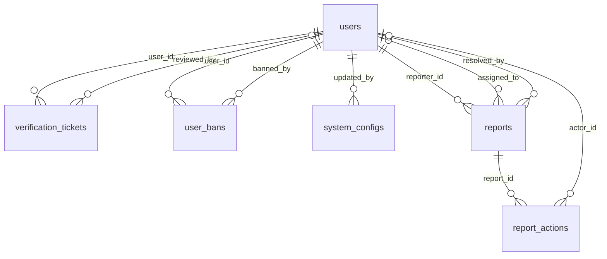

## advertisements

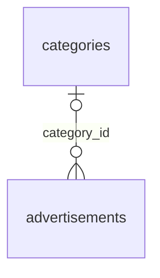

## audit

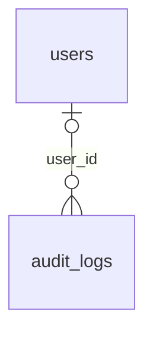

## categories

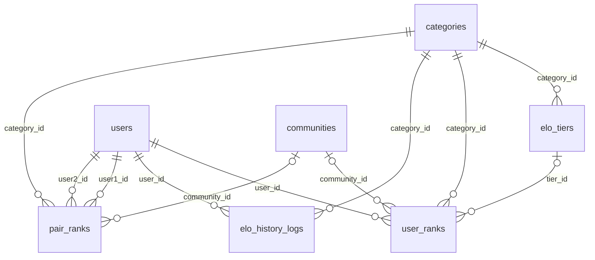

## club-match-sessions

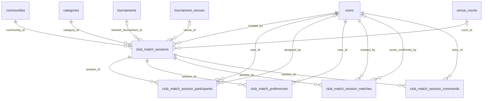

## club-standalone-matches

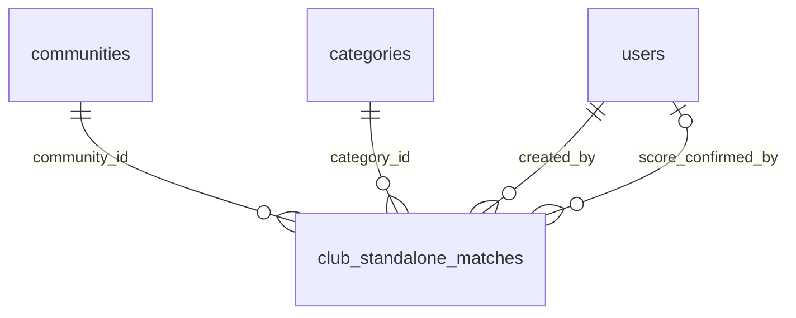

## communities

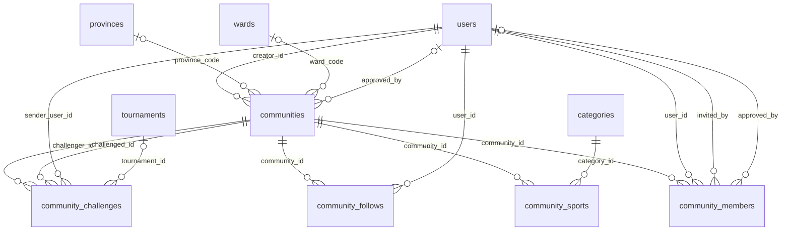

## community_gallery

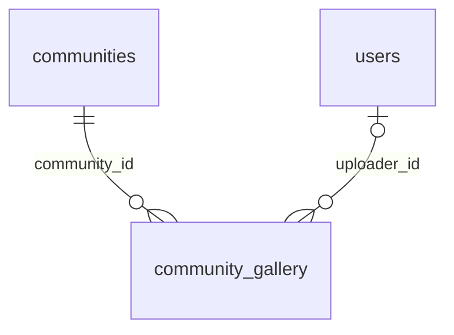

## community_rankings

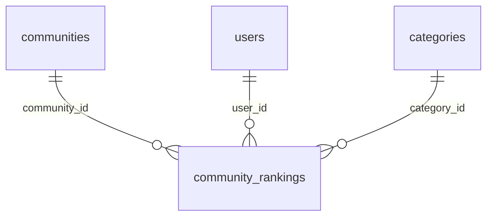

## community_social

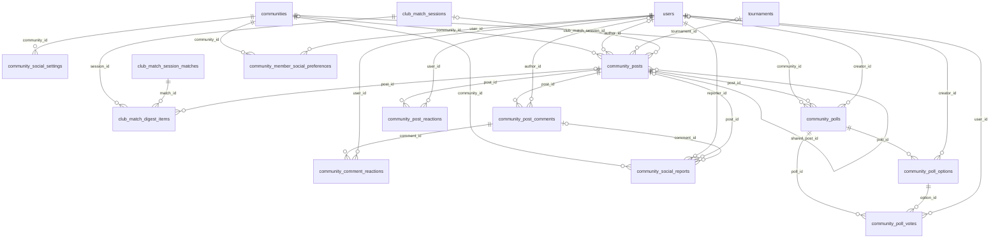

## community_tag_presets

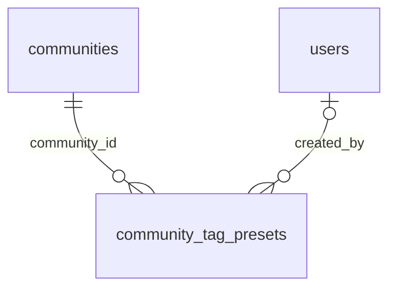

## football

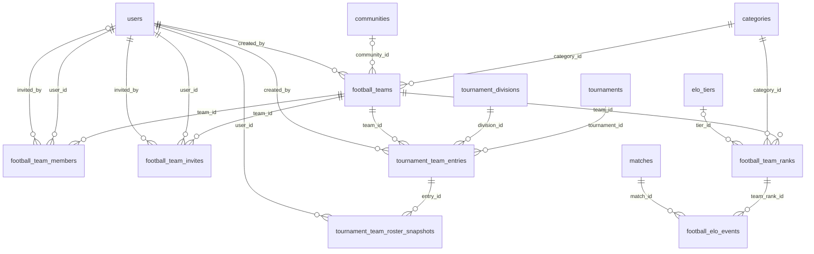

## livestream

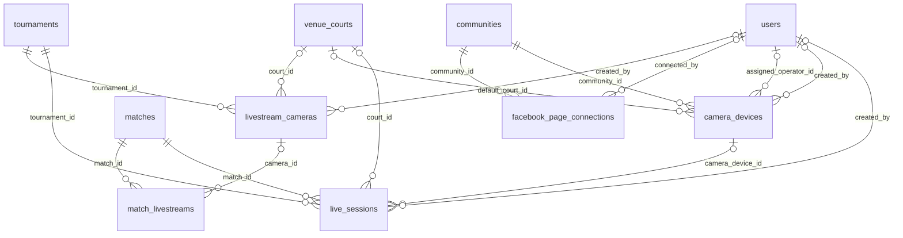

## matches

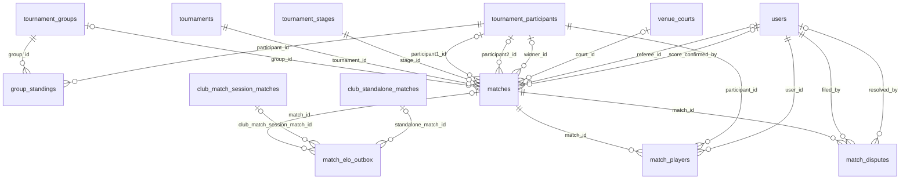

## notifications

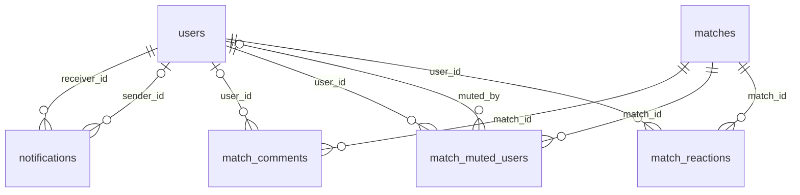

## otp_codes

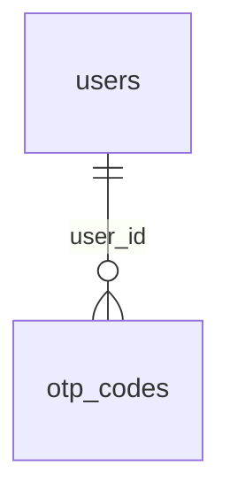

## payments

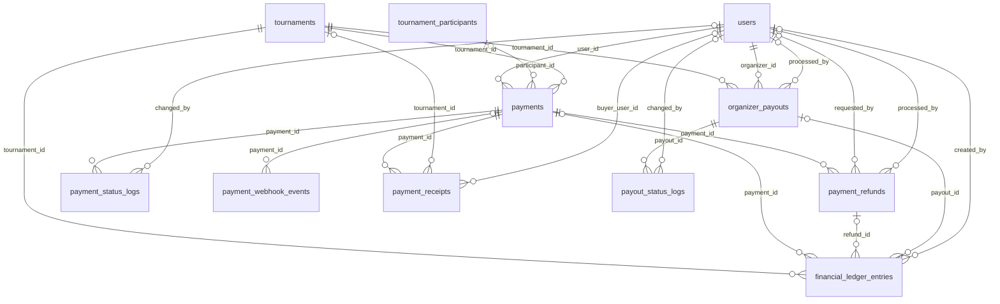

## ranking-admin

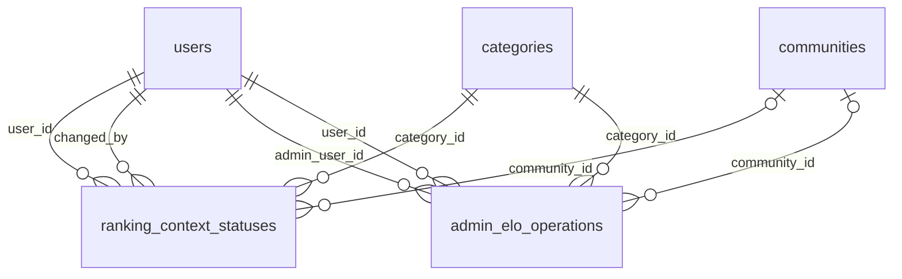

## regions

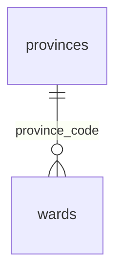

## series

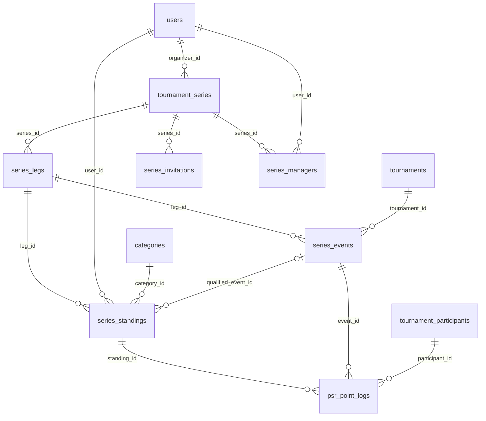

## social-sessions

```mermaid
erDiagram
  communities |o--o{ social_sessions : "community_id"
  users ||--o{ social_sessions : "host_user_id"
  categories ||--o{ social_sessions : "category_id"
  tournament_venues |o--o{ social_sessions : "venue_id"
  venue_courts |o--o{ social_sessions : "court_id"
  social_sessions ||--o{ social_session_participants : "session_id"
  users |o--o{ social_session_participants : "user_id"
```

## social

```mermaid
erDiagram
  users ||--o{ friendships : "sender_id"
  users ||--o{ friendships : "receiver_id"
  communities |o--o{ chat_rooms : "community_id"
  social_sessions |o--o{ chat_rooms : "social_session_id"
  chat_rooms ||--o{ chat_room_members : "room_id"
  users ||--o{ chat_room_members : "user_id"
  chat_rooms ||--o{ chat_messages : "room_id"
  users |o--o{ chat_messages : "sender_id"
  users |o--o{ chat_messages : "revoked_by"
  users |o--o{ chat_messages : "pinned_by"
  chat_messages ||--o{ chat_message_reactions : "message_id"
  users ||--o{ chat_message_reactions : "user_id"
  chat_rooms ||--o{ chat_read_states : "room_id"
  users ||--o{ chat_read_states : "user_id"
  users ||--o{ chat_blocks : "blocker_id"
  users ||--o{ chat_blocks : "blocked_id"
```

## tournament-roster-import-batches

```mermaid
erDiagram
  tournaments ||--o{ tournament_roster_import_batches : "tournament_id"
  users ||--o{ tournament_roster_import_batches : "manager_user_id"
```

## tournament_divisions

```mermaid
erDiagram
  tournaments ||--o{ tournament_divisions : "tournament_id"
  tournament_venues |o--o{ tournament_divisions : "venue_id"
```

## tournament_sponsors

```mermaid
erDiagram
  tournaments ||--o{ tournament_sponsors : "tournament_id"
  users ||--o{ tournament_sponsors : "created_by"
  users ||--o{ tournament_sponsors : "updated_by"
```

## tournaments

```mermaid
erDiagram
  users ||--o{ parent_tournaments : "created_by"
  parent_tournaments |o--o{ tournaments : "parent_id"
  communities |o--o{ tournaments : "community_id"
  categories ||--o{ tournaments : "category_id"
  users ||--o{ tournaments : "created_by"
  tournament_venues |o--o{ tournaments : "venue_id"
  tournaments ||--o{ tournament_stages : "tournament_id"
  tournament_divisions |o--o{ tournament_stages : "tournament_division_id"
  tournament_venues |o--o{ tournament_stages : "venue_id"
  tournament_stages ||--o{ tournament_groups : "stage_id"
  tournaments ||--o{ tournament_participants : "tournament_id"
  tournament_divisions |o--o{ tournament_participants : "tournament_division_id"
  tournament_groups |o--o{ tournament_participants : "group_id"
  users ||--o{ tournament_participants : "registered_by"
  users |o--o{ tournament_participants : "partner_user_id"
  tournament_participants ||--o{ tournament_rosters : "participant_id"
  users ||--o{ tournament_rosters : "user_id"
  tournaments ||--o{ tournament_referees : "tournament_id"
  users ||--o{ tournament_referees : "user_id"
  users |o--o{ tournament_referees : "assigned_by"
  tournaments ||--o{ tournament_staff : "tournament_id"
  users ||--o{ tournament_staff : "user_id"
  users |o--o{ tournament_staff : "created_by"
  tournaments ||--o{ tournament_follows : "tournament_id"
  users ||--o{ tournament_follows : "user_id"
```

## user-devices

```mermaid
erDiagram
  users ||--o{ user_device_tokens : "user_id"
```

## users

```mermaid
erDiagram
  users ||--o{ auth_providers : "user_id"
  users ||--o{ user_to_roles : "user_id"
  roles ||--o{ user_to_roles : "role_id"
  users |o--o{ user_to_roles : "assigned_by"
  users ||--o{ profiles : "user_id"
  provinces |o--o{ profiles : "province_code"
  users ||--o{ sessions : "user_id"
  users ||--o{ organizer_reviews : "organizer_id"
  users ||--o{ organizer_reviews : "reviewer_id"
  tournaments ||--o{ organizer_reviews : "tournament_id"
  users ||--o{ user_change_requests : "user_id"
```

## venues

```mermaid
erDiagram
  users |o--o{ tournament_venues : "owner_user_id"
  tournament_venues ||--o{ venue_courts : "venue_id"
  tournament_venues ||--o{ venue_pricing_rules : "venue_id"
  venue_courts |o--o{ venue_pricing_rules : "court_id"
  tournament_venues ||--o{ court_bookings : "venue_id"
  venue_courts ||--o{ court_bookings : "court_id"
  users ||--o{ court_bookings : "user_id"
```

## zalo-notification

```mermaid
erDiagram
  users |o--o{ zalo_notification_outbox : "recipient_user_id"
```
